# Admin guide — running your website

*For the owner and staff of Triple A International. No technical knowledge needed.*

Your admin panel is at **https://tripleaint.tw/admin**. Everything visitors see on the website is controlled from here. **Changes go live the moment you save.**

> The screenshots show sample data. Yours will look the same with your own products.

**Contents:** [1 Sign in](#1-sign-in-and-keep-your-account-safe) · [2 Dashboard](#2-the-dashboard) · [3 Add a product](#3-add-a-product) · [4 Manage products](#4-edit-duplicate-hide-and-delete-products) · [5 Bulk import](#5-import-many-products-from-excel) · [6 Photos by ZIP](#6-add-photos-in-bulk-with-a-zip) · [7 Inquiries](#7-handle-inquiries) · [8 Messages](#8-contact-messages-and-newsletter) · [9 Freight rates](#9-update-freight-rates) · [10 Loading photos](#10-upload-container-loading-photos) · [11 Edit pages](#11-edit-the-words-on-your-website) · [12 Blog](#12-write-a-blog-post) · [13 Categories & makes](#13-categories-makes-and-models) · [14 Photos library](#14-media-library) · [15 Team](#15-team-members-and-roles) · [16 Settings](#16-settings) · [17 Tips](#17-tips-and-good-habits) · [18 Problems](#18-if-something-goes-wrong)

---

## 1. Sign in and keep your account safe

1. Go to `/admin` and enter your email and password.
2. **First time only:** open **My account** (click your name, top right) and
   - **Change password** (at least 10 characters, with a letter and a number).
   - **Turn on two-factor sign-in:** click *Set up*, scan the QR code with an authenticator app on your phone (Google Authenticator, Microsoft Authenticator, Authy, 1Password…), type the 6-digit code, then **save the 10 backup codes** somewhere safe (a password manager or printed). Each backup code works once if you lose your phone.
3. After 8 wrong passwords in 15 minutes, sign-in pauses for a while. Just wait and try again.

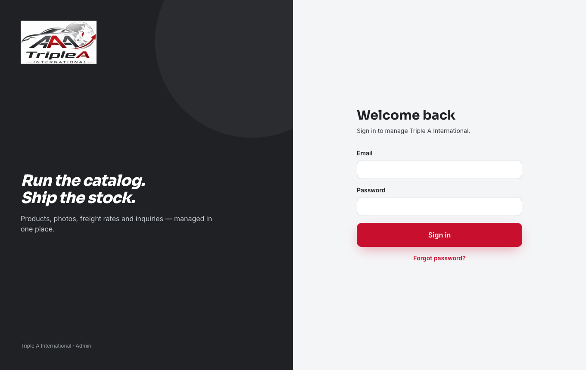

**Forgot your password?** Click *Forgot password?* on the sign-in page; we email you a link that works for one hour. **Locked out of two-factor?** Another super admin can reset it for you under *Users & roles* (the shield icon).

The moon/sun button (top bar) switches **dark mode**. Press **`/`** (or **Ctrl/⌘ + K**) to jump to the search box.

---

## 2. The dashboard

The first page after signing in shows what needs attention.

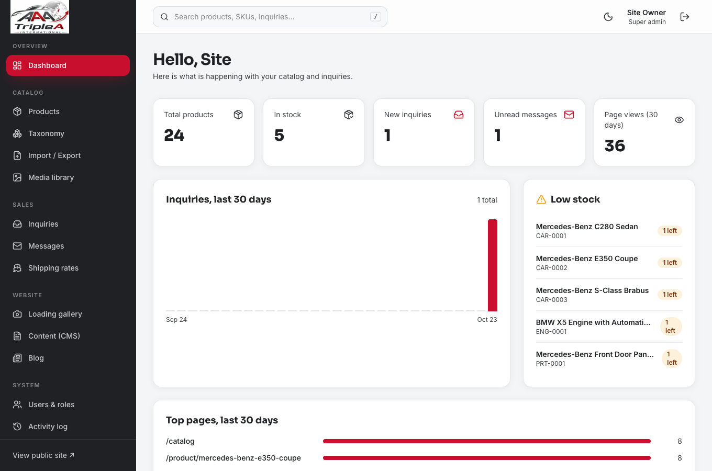

- **Cards:** total products, products in stock, **new inquiries**, **unread messages**, page views (last 30 days; anonymous, no cookies).
- **Inquiries chart:** how many came in each day this month.
- **Low stock:** products with 2 or fewer units left.
- **Top pages:** the most-visited pages.
- **Recent inquiries:** click a reference to open it.

---

## 3. Add a product

**Products → New product.**

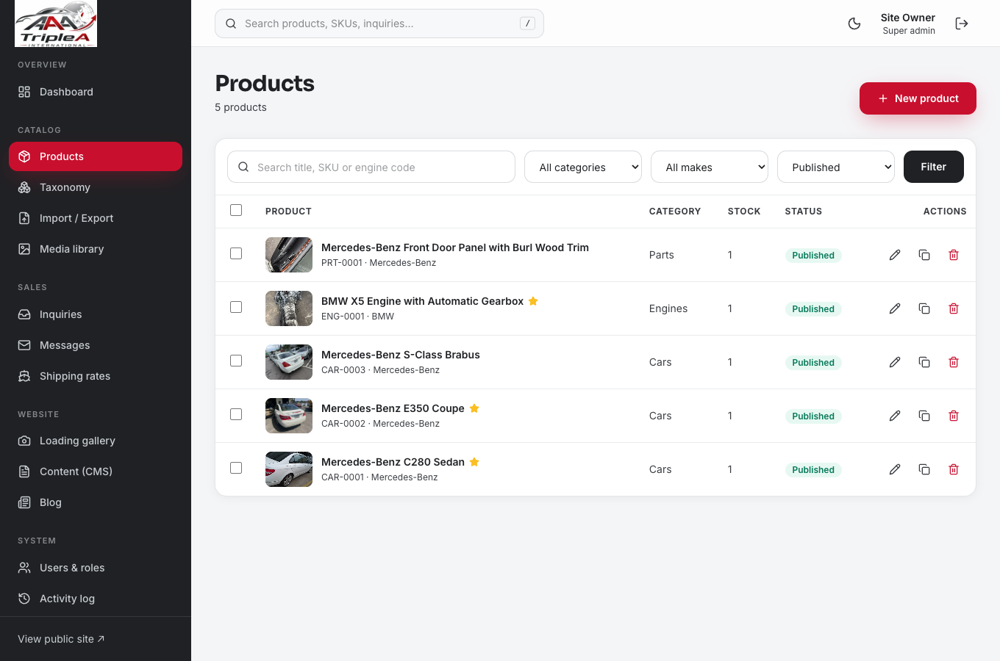

**Basics**
- **Title:** what buyers see, e.g. *Toyota 2GR-FE 3.5L V6 Engine*. The web address (“slug”) fills in by itself.
- **SKU / code:** your own unique stock number, e.g. `ENG-0871`. (It must be unique.)
- **Category** (required), **Make** and **Model**. If a model is missing, add it under *Categories & makes* first (or create it automatically during import).
- **Year from / to:** the model years it fits, e.g. 2012 to 2017.

**Photos**
- Drag photos into the box, or click to browse. You can add many at once (JPG, PNG, WebP, even iPhone HEIC; up to 10 MB each). They are resized and optimised automatically.
- The **first photo is the cover**. Drag photos to change the order, or click the ★ on one to make it the cover. The bin removes a photo from this product.
- Products without photos are flagged in the list: buyers trust products with photos.

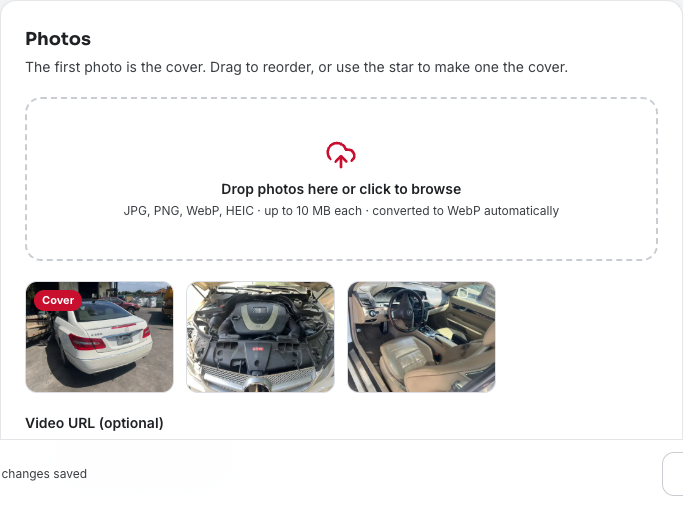

**Specifications**
- Fill the standard boxes: engine code, displacement (cc), fuel, transmission, drive, condition, weight, mileage.
- **Extra specifications:** anything else, as *Name → Value* pairs (e.g. *Compatible with → Toyota Camry 2012–2017*). They appear in the spec table on the product page.

**Description** is a simple editor (bold, headings, lists, links). **What is included** is a list such as *Alternator, A/C compressor, ECU*.

**Stock & price**
- **Quantity in stock.** Products with 2 or fewer show “Only 1 left”; 0 shows “Sold”.
- **Show price publicly:** *off* = visitors see **“Price on request”** (recommended for export). Turn it on only when you want the price displayed.

**Publishing**
- **Draft** = hidden. **Published** = visible. **Sold** = shown as sold. **Archived** = hidden but kept.
- **Featured** puts it in the home page carousel.
- Click **Publish** (or *Save as draft*). A confirmation appears. Your work is also kept in your browser as you type: if the page closes by accident, you are offered to **Restore** it.

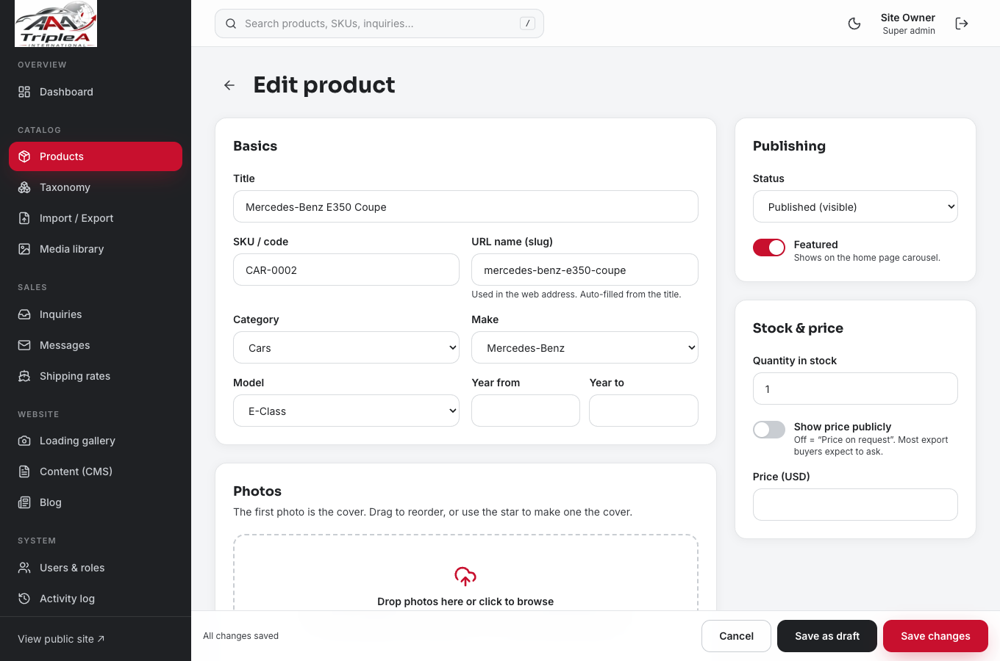

---

## 4. Edit, duplicate, hide and delete products

On **Products** you can search (title, SKU or engine code) and filter by category, make or status.

- **Pencil** = edit. **Copy icon** = duplicate (makes a draft copy with a new SKU: handy for similar items).
- **Tick boxes** select several products, then use the bar that appears: **Publish · Unpublish · Archive · Delete**.
- **Delete** asks you to confirm. It cannot be undone, and **Archive is safer** if you only want to hide something. Old inquiries keep the product name and SKU either way.
- The yellow bar at the top tells you how many products have no photo.

---

## 5. Import many products from Excel

For hundreds of items, use **Import / Export**.

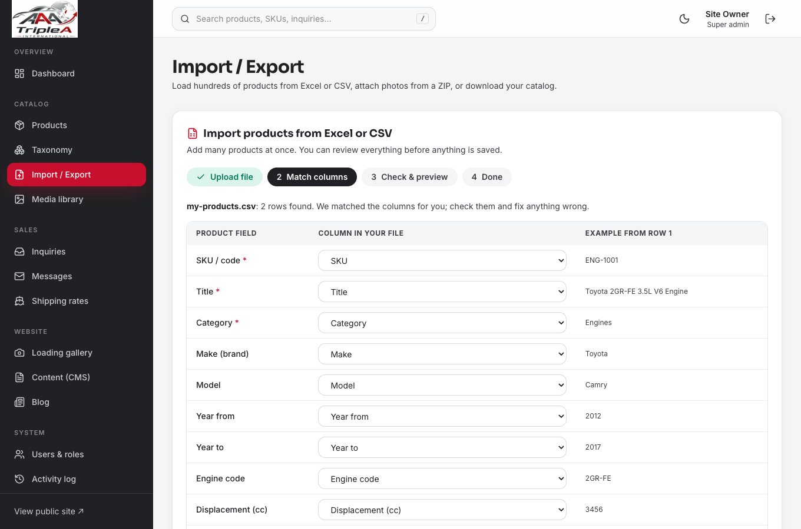

1. **Download the template** (Excel or CSV). Fill it in. Leave cells empty when you do not know a value. Required: **SKU, Title, Category**.
   - Category: one of your categories (*Cars, Engines, Parts, Car Cuts*).
   - Make/Model: any text. “Toyota” matches “Toyota & Lexus”. Missing ones can be created automatically.
   - Fuel: *Petrol, Diesel, Hybrid, Electric*. Transmission: *AT, MT, CVT*. Drive: *2WD, 4WD*. Yes/no columns accept *yes/no*.
   - Extra specs: `Name: Value | Name: Value`.
   - You can also use your own existing spreadsheet: the importer recognises many common headers (Item Code, Brand, Qty…) and lets you match the rest.
2. **Upload** the file (up to 5,000 rows).
3. **Match columns.** Check that each product field points at the right column of your file. Required ones are marked *.
   - **Update products that already exist:** off = existing SKUs are skipped. On = they are updated, but **only cells you filled in are changed; empty cells never erase anything**.
   - **Create makes/models that do not exist yet** (recommended).
   - **New products are:** Drafts (safest) or Published.
4. **Check my data.** Nothing is saved yet. You see how many will be created, updated, skipped, and which rows have problems **with the reason** (unknown category, duplicate SKU, bad number…). You can download the list of problems.

   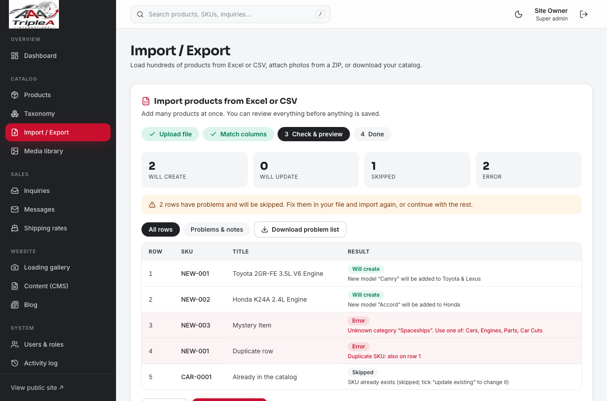
5. **Import.** Valid rows are saved; rows with problems are skipped. Fix those in your file and import again (turn on *update existing* if some of the file was already imported).

**Export:** the same page downloads **all products** (Excel or CSV) in the exact layout the importer reads: edit in Excel, then import again to update.

---

## 6. Add photos in bulk with a ZIP

After importing products, add all their photos at once.

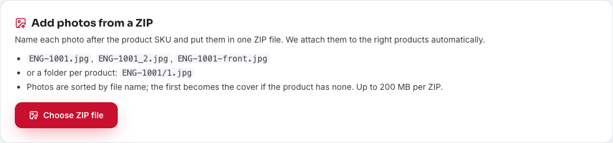

1. Name each photo after the product's **SKU**: `ENG-0871.jpg`, `ENG-0871_2.jpg`, `ENG-0871-front.jpg`.
   *Or* put photos in a folder per product: `ENG-0871/1.jpg`, `ENG-0871/2.jpg`.
2. Put everything in **one ZIP** (up to 200 MB / 1,500 files; make several ZIPs for more).
3. **Choose ZIP file.** You get a report: how many photos were added to how many products, and a list of **files that matched no SKU** (usually a typo in the name).

Photos are added in file-name order after any photos the product already has; the first becomes the cover if there was none. Uploading the same ZIP twice does not create duplicates.

---

## 7. Handle inquiries

Every inquiry from the website is saved here **and** emailed to you.

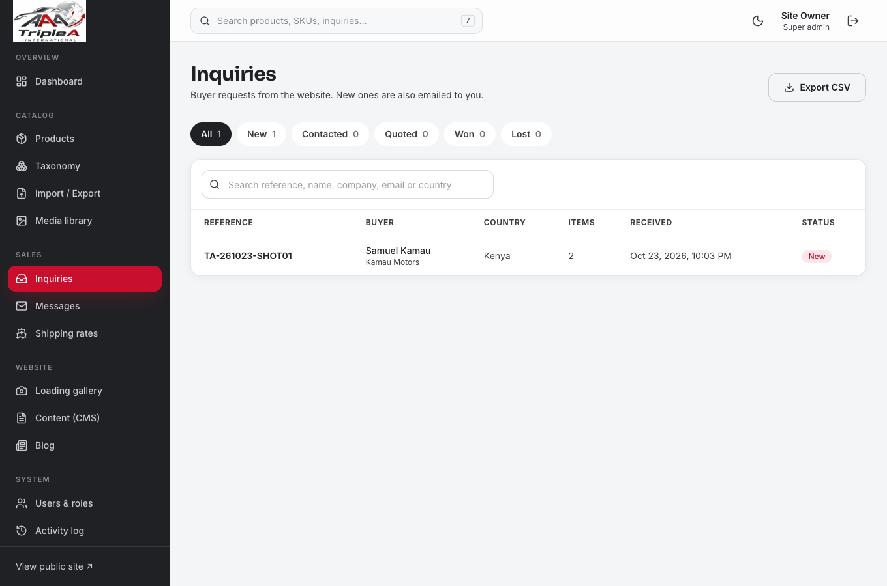

- **Tabs** filter by status: **New → Contacted → Quoted → Won / Lost**. Search by reference, name, company, email or country.
- Open one to see the buyer, their country and port, the items and quantities (with their notes), and the message. The **WhatsApp** link opens a chat with their number.
- **Status:** change it as you work (it saves immediately).
- **Internal notes:** only your team sees these (e.g. “Quoted FOB $4,200, wants November loading”).
- **Reply by email:** write the message and send. It is emailed to the buyer, logged under *Emails sent*, and a New inquiry becomes Contacted automatically.
- **Export CSV** (top right) downloads inquiries for Excel.

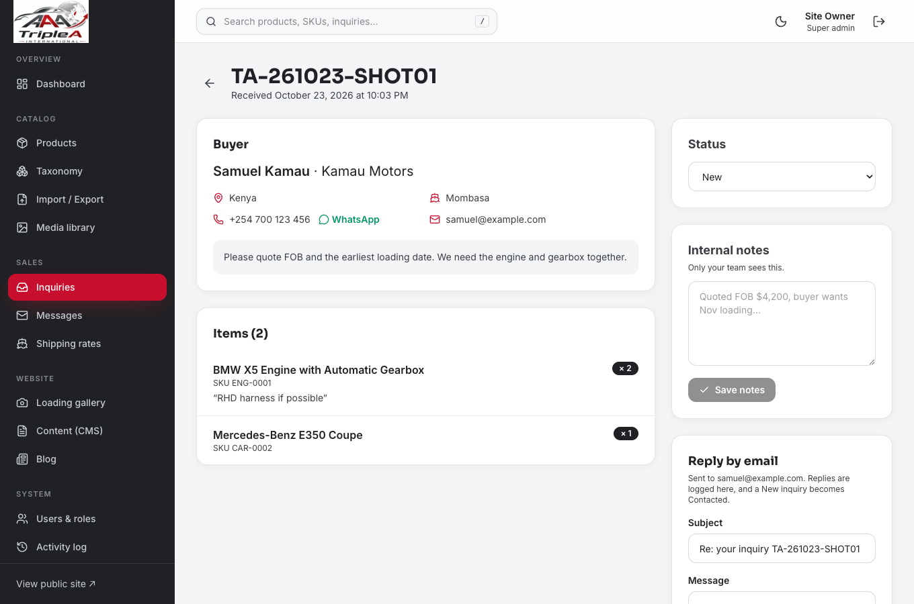

Buyers also receive an automatic confirmation email with their reference number.

---

## 8. Contact messages and newsletter

**Messages** shows what people typed in the **Contact** page form. Unread ones have a red dot and bold text. Click to read (it becomes read), then *Reply by email*, *Mark unread* or *Delete*.

The **Subscribers** tab lists footer newsletter sign-ups, with **Export CSV**. Only email people who signed up.

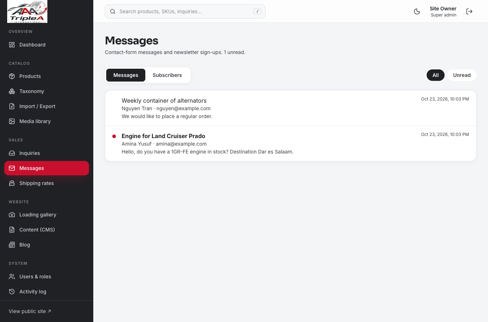

---

## 9. Update freight rates

**Shipping rates** is the table on your public *Shipping* page.

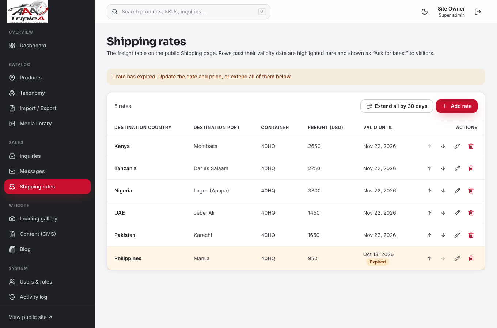

- **Add rate:** destination country, port, container type, price in USD, and **valid until** date.
- Rates past their date are **highlighted in yellow here** and shown to visitors as *“Ask for latest”* (they never see an out-of-date price as current).
- Monthly chore when the shipping lines confirm the same prices: **Extend all by 30 days**. If prices changed, edit the rows instead.
- The arrows reorder rows; the pencil edits; the bin deletes.

---

## 10. Upload container-loading photos

**Loading gallery** builds the public *Loading* page and the strip on the home page.

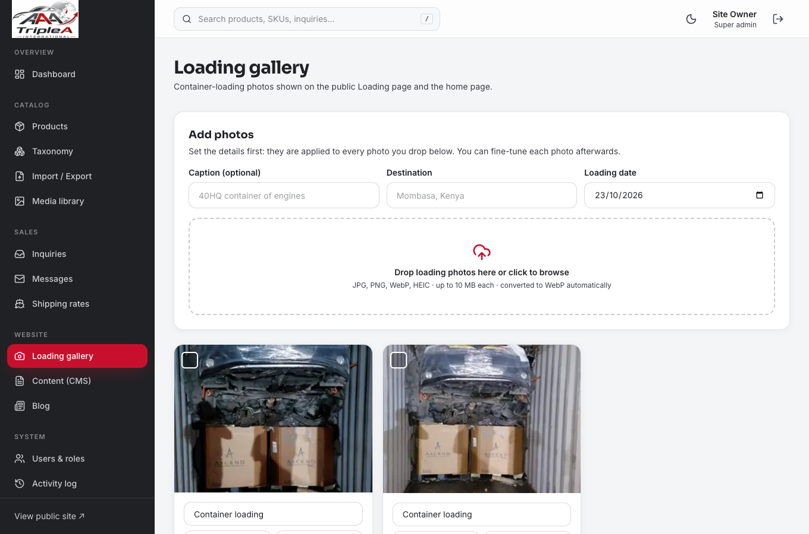

1. Fill in **Destination** (e.g. *Mombasa, Kenya*), **Loading date** and optionally a **Caption**: these apply to every photo you drop next.
2. Drop many photos at once.
3. Fine-tune any single photo (caption, destination, date) below and click *Save changes*.
4. To remove: tick photos → **Remove**. They disappear from the website; the files stay in the Media library.

Visitors can filter by year and destination, and open photos full-screen.

---

## 11. Edit the words on your website

**Content (CMS)** has one card per area. Open a card, change text, press **Save changes**, then **View page ↗** to see it.

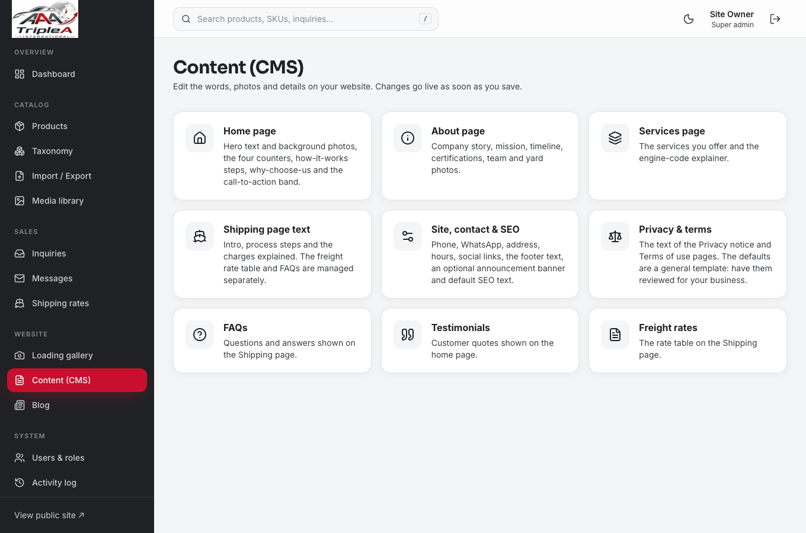

| Card | What you can change |
|---|---|
| **Home page** | Headline and sub-text, button names, trust points, background photos, the four counters (years, containers, countries, items), how-it-works steps, why-choose-us, the call-to-action band |
| **About page** | Company story, mission, timeline, certifications, team (with photos), yard photos |
| **Services page** | Each service with bullet points, the engine-code table |
| **Shipping page text** | Introduction, process steps, “charges explained”, the note under the rate table |
| **Site, contact & SEO** | **Phone, WhatsApp number, email, address, opening hours, map location, social links, footer text, an announcement banner for the top of every page, and the default Google title/description.** Changing the WhatsApp number updates *every* WhatsApp button on the site |
| **Privacy & terms** | The legal pages. The starting text is a **general template: have it checked for your business** |
| **FAQs** | Questions and answers on the Shipping page (reorder with arrows, hide with the visible switch) |
| **Testimonials** | Customer quotes on the home page. Only publish quotes you have permission to use |

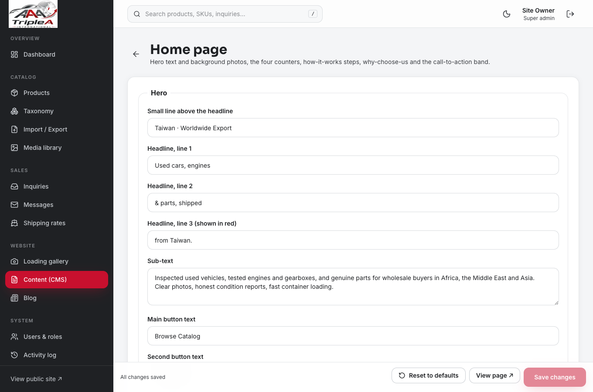

Lists (steps, timeline, counters…) have **Add**, **move up/down** and **remove** buttons. **Reset to defaults** (bottom) restores the original text of that page after a confirmation.

> **WhatsApp number format:** digits only with country code, e.g. `886912345678` (no `+`, spaces or dashes).

---

## 12. Write a blog post

**Blog → New post.** Good posts bring visitors from Google: *“How to import a used engine from Taiwan”*, *“What does an engine code tell you?”*

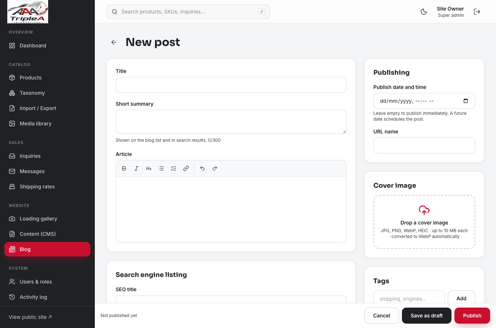

- Title, short summary (shown in the list and Google), the article, a cover image and tags.
- **Save as draft** keeps it hidden. **Publish** makes it live now.
- **Schedule:** pick a future **Publish date and time**, then click **Schedule**: it goes live by itself at that moment.
- Open the SEO section to control the Google title and description.

---

## 13. Categories, makes and models

**Taxonomy** controls the menus and the catalog filters.

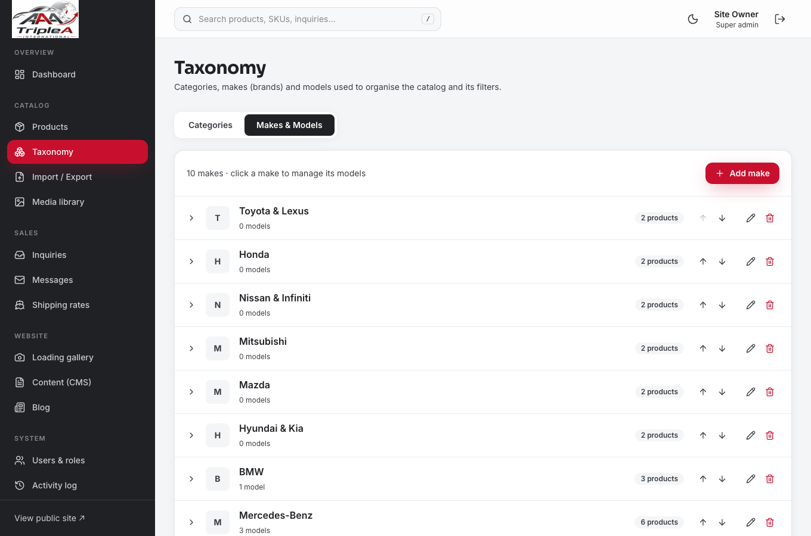

- **Categories** and **Makes & models**: add, rename, add a logo, and reorder with the arrows (the order here is the order visitors see).
- Click a make to manage its **models**.
- You cannot delete something that products still use. Move the products first.

---

## 14. Media library

**Media library** holds every uploaded picture. Search by file name, click one for details, and see **where it is used**. Deleting a file that is in use warns you and removes it from those products too.

---

## 15. Team members and roles

*(Super admins only.)* **Users & roles** → *Add user*.

- **Super admin:** everything, including users and Settings.
- **Editor:** products, photos, inquiries, content, blog; **not** users or Settings.
- You can change roles, disable accounts, set a new password, reset someone's two-factor, or delete an account. There must always be one active super admin.

**Activity log** lists who did what and when (sign-ins, edits, deletions).

---

## 16. Settings

*(Super admins only.)*

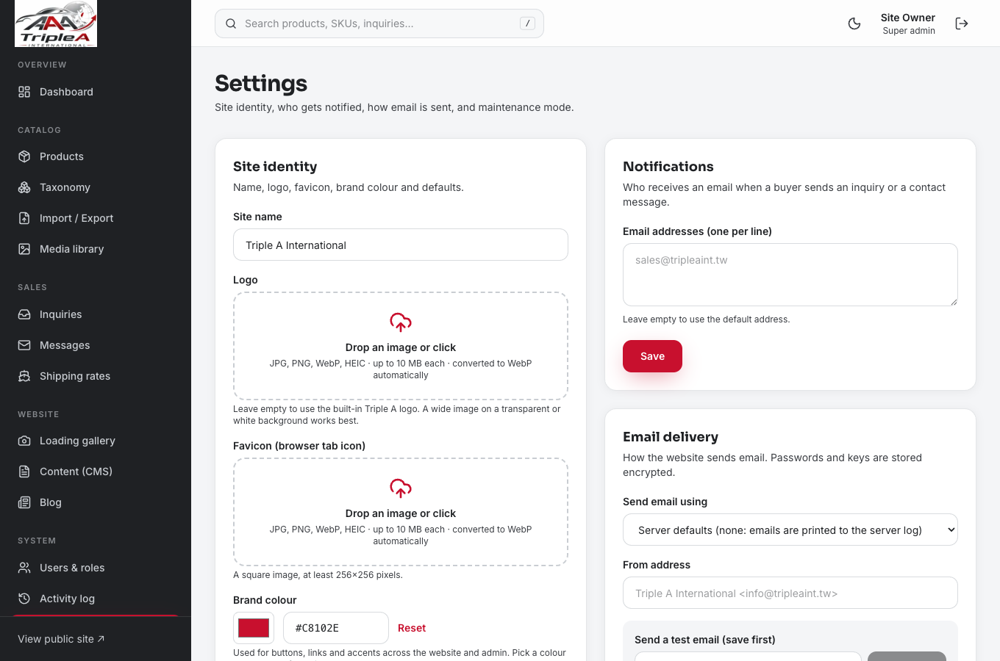

- **Site identity:** site name, **logo**, **favicon** (the little tab icon), **brand colour** (changes buttons and accents across the whole site: pick one dark enough for white text), default currency, and an option to stamp your logo on new photos.
- **Notifications:** which email addresses receive new inquiries and contact messages (one per line).
- **Email delivery:** how the site sends email: **SMTP** (your mail host) or **Resend**. Passwords/keys are stored encrypted. Use **Send a test email** to confirm it works.
- **Maintenance mode:** shows visitors a polite “back soon” page while you work. **You can still see and edit the real site** while signed in.

---

## 17. Tips and good habits

- **Photos sell.** Show the whole item, the label/engine code, and any damage. 4–8 photos per product.
- **Keep SKUs consistent** (`ENG-0001`, `CAR-0001`…): it makes imports, photo ZIPs and inquiries easy.
- **Use “Price on request”** unless you want a public price. Buyers inquire anyway.
- **Mark sold items as Sold** (or archive them) so buyers are not disappointed.
- **Update freight rates monthly.** Expired rates show “Ask for latest”.
- **Reply to inquiries within a day.** Fast replies win export deals. Use WhatsApp for quick questions.
- **Check *Inquiries* and *Messages* daily**; the dashboard shows the counts.
- **Back up.** Ask whoever runs the server to confirm backups are copied off the server (see README → Backups).

---

## 18. If something goes wrong

| Problem | What to do |
|---|---|
| I can't sign in | Check email/password; wait 15 minutes after repeated failures; use *Forgot password*; with 2FA use a backup code, or ask a super admin to reset your 2FA. |
| An import row says “Unknown category” | The Category cell must match one of your categories (Cars, Engines, Parts, Car Cuts). |
| “SKU already exists” on import | Tick *Update products that already exist*, or change the SKU. |
| Photo ZIP says a file “did not match any SKU” | Check the file name starts with the exact SKU (`ENG-0871_2.jpg`). |
| A photo won't upload | It must be an image under 10 MB (JPG, PNG, WebP, HEIC). |
| Emails are not arriving | *Settings → Email delivery → Send a test email.* Check the spam folder and the SPF/DKIM records (README §6). |
| I changed text but the site looks the same | Refresh the page (Ctrl/⌘ + Shift + R). Changes are live instantly. |
| I deleted something by mistake | Products/photos cannot be un-deleted from the admin: ask for a **backup restore** (README §7). Prefer *Archive* over *Delete*. |
| The site shows “Back soon” | Maintenance mode is on: *Settings → Maintenance mode*. |
